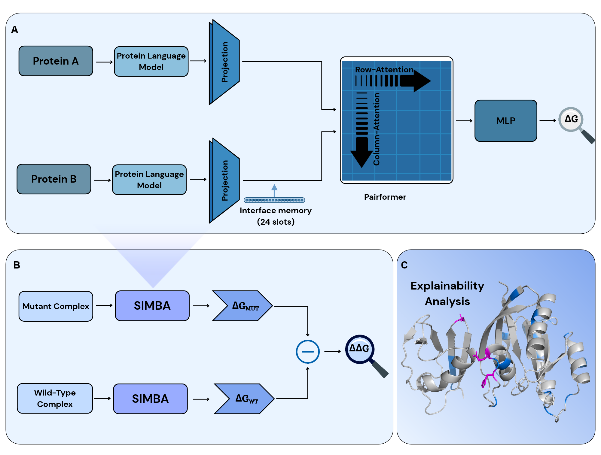

# SIMBA: Sequence-based prediction of protein binding affinity and mutation effects via interface memory

## Abstract

Predicting protein-protein binding affinity from sequence information alone remains a significant
challenge for large-scale affinity screening. While structure-based approaches generally achieve high
accuracy, they are often difficult to scale when complex structural data is unavailable. Here, we
introduce SIMBA (Sequence-Informed Model for Binding Affinity Prediction), which combines a frozen
protein language model representation with a fixed-size partner memory and a lightweight Pairformer,
refining residue-memory interactions before energy regression. The model demonstrates consistent
generalisation under strict splits, outperforms standard baselines, and improves on existing methods
for predicting absolute affinity and mutation effects. Residue attributions highlight experimentally
defined interface regions, supporting the conclusion that the model's architecture captures
partner-specific interaction signals from the sequence alone. Together, these results position
fixed-size partner conditioning with pairwise refinement as an efficient sequence-based method for
predicting partner-conditioned binding affinity.

## Architecture

<p align="center">
  
</p>

**(A)** Two protein sequences are encoded by a frozen protein language model (ESM-2-650M) and
projected to 256 dimensions. Cross-attention compresses the partner into a fixed-size interface memory
(24 latent slots); a Pairformer-lite block applies row and column attention over the self-token x
memory-slot map, and an MLP maps the pooled representation to a scalar binding free energy (&Delta;G).
**(B)** Mutation effects use the same model twice: &Delta;&Delta;G = &Delta;G(mutant) - &Delta;G(wild type).
**(C)** Residue-level attributions (Integrated Gradients) are computed post hoc for explanation; no
structural coordinates are supplied to the model.

The "interface memory" is not a persistent store and retrieves nothing from other complexes: it is a
per-input, fixed-size bottleneck on the partner chain, rewritten for every input.

## 1. Setup

### Environment

```powershell
conda env create -f environment.yml
conda activate simba
```

or with an existing Python 3.12 + CUDA 11.8 environment:

```powershell
pip install -r requirements.txt
```

A CUDA GPU is required for training/embedding (all results were produced on a single consumer
GPU, 16 GB VRAM).

### MINT backbone (optional, needed for 3 of the experiments)

The MINT comparison, the frozen-backbone ablation, and the backbone x head factorial all use MINT
as an alternative frozen backbone. Its code and released checkpoint are a separate dependency:

```powershell
git clone https://github.com/VarunUllanat/mint third_party/mint
# then follow that repo's instructions to download its released checkpoint
```

Everything else, including the main 3-split ablation below, runs without this.

### Data

```powershell
python scripts/download_data.py
```

Fetches SKEMPI2 and AB-Bind automatically. Two datasets need a one-time manual step:

- **AbDesign**: register at https://naturalantibody.com/ab-design/, save the file at
  `data/raw/abdesign/abdesign_raw.csv`.
- **Kastritis-lineage benchmark** and **ATLAS TCR:pMHC**: both public; see
  `simba/data/build_affinity_benchmark.py` and `simba/data/build_atlas.py` for expected filenames
  and source URLs.

ESM-2/MINT/AbLang2 embeddings are computed once per unique sequence and cached to disk
(`data/processed/embeddings_cache/`) on first use of any script — this is not shipped (it grows to
tens of GB) but is fully deterministic to regenerate, since the backbone is frozen.

## 2. Running the main experiment

The paper's central result is a 3-architecture x 3-split-protocol ablation on the combined
general-PPI pool (7,247 examples, 541 complexes): SIMBA (Pairformer) vs. two baselines
(Concat+MLP, Cross-attn+MLP), each trained under random-complex, sequence-similarity, and
cold-target 5-fold cross-validation.

This is driven by `simba/eval_skempi2_5fold.py`, a standard argparse CLI:

```powershell
python -m simba.eval_skempi2_5fold `
    --pool combined `           # skempi2 | combined
    --split cold_target `       # complex | seq_similarity | cold_target
    --model pairformer `        # concat_mlp | cross_attn_mlp | pairformer
    --backbone facebook/esm2_t33_650M_UR50D `
    --epochs 40 --batch-size 16 --lr 1e-3 --weight-decay 1e-4 `
    --val-frac 0.15 --seed 0 `
    --out results.json --predictions-out results.predictions.json
```

| Flag | Values | Meaning |
|---|---|---|
| `--pool` | `skempi2`, `combined` | `skempi2`: expanded SKEMPI2 only (7,046 ex. / 340 cplx.). `combined`: + Kastritis-lineage benchmark46 + ATLAS TCR:pMHC (7,247 ex. / 541 cplx.) |
| `--split` | `complex`, `seq_similarity`, `cold_target` | Fold-construction protocol, increasing strictness (see paper Section 4.3) |
| `--model` | `concat_mlp`, `cross_attn_mlp`, `pairformer` | Architecture under test; `pairformer` is SIMBA |
| `--backbone` | any ESM-2 HF checkpoint name | Frozen encoder |
| `--epochs`, `--batch-size`, `--lr`, `--weight-decay`, `--val-frac`, `--seed` | numeric | Standard training hyperparameters |
| `--out` | path | Per-fold summary metrics (JSON) |
| `--predictions-out` | path | Raw per-example predictions, for later bootstrap CIs / figures without retraining |

To reproduce the full ablation matrix (all 3 models x all 3 splits, plus the SKEMPI2-only
complex-split check) in one go:

```powershell
.\scripts\run_main_results.ps1
```

Every other experiment in the paper (Kastritis-lineage vs. PPI-Graphomer, AbDesign, the MINT
comparison, the frozen-backbone ablation, zero-/few-shot generalization, chain-order
symmetrization, gating, the direct-ΔΔG-head control, the backbone x head factorial, and the
interpretability analysis) has its own argparse-documented script under `simba/eval_*.py` /
`simba/interpretability_*.py`; run all of them via:

```powershell
.\scripts\run_all_results.ps1
```

Both scripts are self-documenting — each block prints which experiment it's running and what
flags it's using.

## 3. Memory and depth ablations

The interface-memory ablation and the Pairformer-lite depth sweep are driven by
`simba/eval_memory_size_sweep.py`, on the same cold-target folds as the main ablation:

```powershell
python -m simba.eval_memory_size_sweep `
    --variant memory `          # memory | memory_only | no_memory
    --memory-sizes 8 16 24 32 ` # number of interface-memory slots (default model: 24)
    --layers 1 `                # Pairformer-lite depth (memory / no_memory variants)
    --split cold_target --seed 0 --out results/ablation_memory_size_s0.json
```

| `--variant` | What it tests |
|---|---|
| `memory` | SIMBA: partner compressed into `--memory-sizes` slots, then Pairformer-lite |
| `memory_only` | the 24-slot memory read out by one learned query, no Pairformer-lite |
| `no_memory` | same Pairformer-lite on the full self x partner pair map from raw projected tokens (each chain subsampled to at most 256 / 128 tokens to fit in 16 GB) |

To run everything reported in the paper (3 seeds; resumable, finished outputs are skipped):

```powershell
.\scripts\run_reviewer_ablations.ps1
```

This is the slowest block in the repository (roughly half a day per depth run on a 16 GB GPU).
Aggregated pooled Pearson (mean over 3 seeds) is versioned in
`results_summary/memory_depth_ablation.csv`:

| Variant | Pearson |
|---|---|
| no memory (raw tokens, Pairformer-lite) | 0.668 |
| memory only, no Pairformer-lite | 0.551 |
| memory M = 8 / 16 / 24 (SIMBA) / 32 | 0.658 / 0.656 / 0.654 / 0.663 |
| M = 24, 1 / 2 / 3 Pairformer-lite layers | 0.654 / 0.656 / 0.659 |

Pairformer-lite is the dominant component; the memory matches full-map accuracy at a cost that does
not grow with partner length, and depth beyond one layer makes no measurable difference.

## 4. Figures

```powershell
.\scripts\make_figures.ps1
```

Regenerates every figure from the result JSONs produced above. Pure plotting, no GPU needed.
`simba/make_camera_ready_figures.py` (called by the script above) redraws Figures 2-5 natively at
print size into `figures/camera_ready/`; its bootstrap and permutation results are cached in
`figures/camera_ready/.cache/` so layout-only edits re-render in seconds (delete that folder after
changing any result JSON).

## Repository layout

```
SIMBA/
  simba/                 the package (import as `simba.<module>`)
    models/               AbsoluteAffinityModel (SIMBA) and the two ablation baselines
    features/             frozen-backbone scoring (ESM-2, MINT, AbLang2) + on-disk embedding cache
    data/                 dataset builders (SKEMPI2, AbDesign, RDE-PPI, ATLAS, MINT-protocol split, ...)
    eval_*.py             one script per experiment, each with its own argparse CLI (see below)
    make_*.py             figure-generation scripts (make_camera_ready_figures.py: final print-size Figures 2-5)
    train.py, train_final_checkpoint.py
  tests/                  unit tests
  scripts/
    download_data.py       fetches the public raw datasets
    run_main_results.ps1   the headline 3-architecture x 3-split ablation
    run_all_results.ps1    every other experiment
    run_reviewer_ablations.ps1  memory and Pairformer-depth ablations (3 seeds, cold-target split)
    make_figures.ps1        regenerates figures from result JSONs
  assets/                 README images (architecture diagram)
  results_summary/        small, versioned summaries of results that are expensive to regenerate
  environment.yml / requirements.txt
```

## 5. Tests

```powershell
python -m pytest tests/
```

## 6. Determinism

All split/exclusion rules are seeded and documented in the paper (Section 4.3, "Reproducibility
summary"). Multi-seed results use seeds `[0, 1, 2]` throughout. GPU training is not bitwise-
deterministic across different GPUs/cuDNN versions, so exact digits may drift in the last decimal
place; reported comparisons and their statistical significance (bootstrap CIs, paired permutation
tests) are robust to this.

## Citation

```bibtex
@inproceedings{simba2026,
  title     = {SIMBA: Sequence-based prediction of protein binding affinity and
               mutation effects via interface memory},
  author    = {Harshit Singh and Rajeev Kumar Singh and Satya Pratik Srivastava and Pulkit Mehndiratta},
  year      = {2026}
}
```
